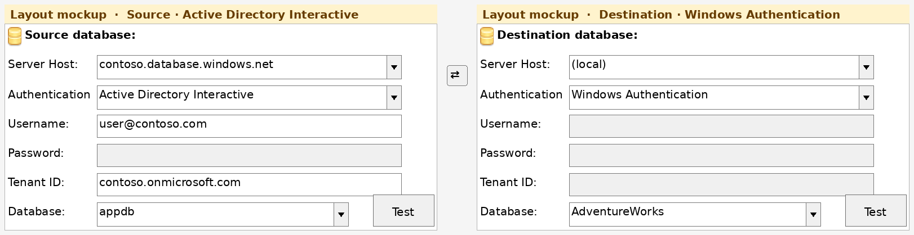
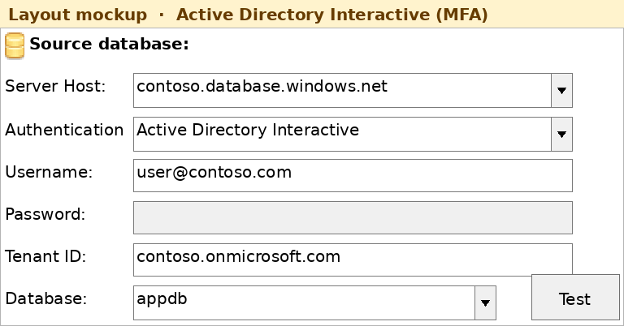
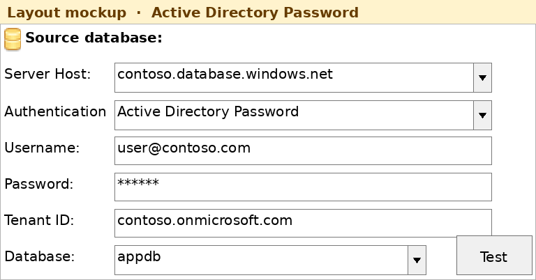
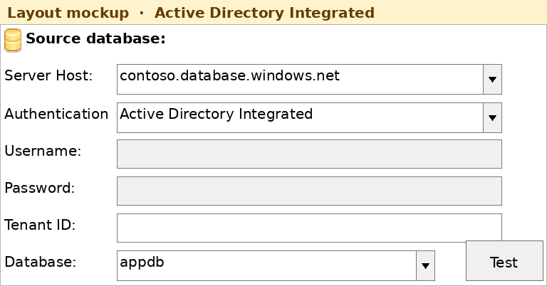
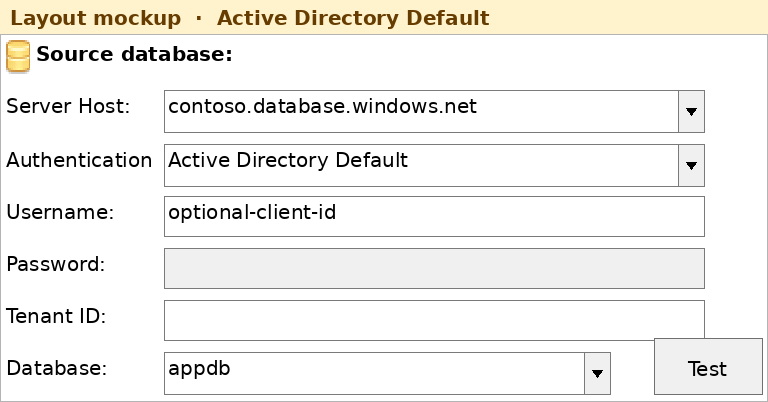
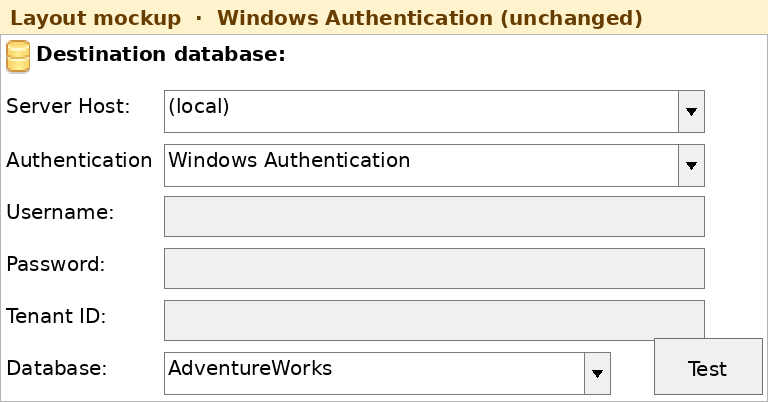
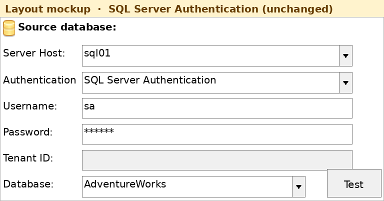

# OpenDBDiff
A database comparison tool for Microsoft SQL Server 2005+ that reports schema differences and creates a synchronization script.

[](https://github.com/OpenDBDiff/OpenDBDiff/actions/workflows/ci.yml)

[💾 Download latest release](https://github.com/OpenDBDiff/OpenDBDiff/releases/latest)

[💾 Download develop CI build](https://github.com/OpenDBDiff/OpenDBDiff/actions/workflows/ci.yml?query=branch%3Adevelop)

The CI build for `develop` is attached to every workflow run as `OpenDBDiff-WinFormsGUI-*` and
`OpenDBDiff-CLI-*` artifacts (keep a run's download for 14 days).

Open DBDiff can synchronize
* Tables (including Table Options like vardecimal, text in row, etc.)
* Columns (including Computed Columns, XML options, Identities, etc.)
* Constraints
* Indexes (and XML Indexes)
* XML Schemas
* Table Types
* User Data Types (UDT)
* CLR Objects (Assemblies, CLR-UDT, CLR-Store Procedure, CLR-Triggers)
* Triggers (including DDL Triggers)
* Synonyms
* Schemas
* File groups
* Views
* Functions 
* Store Procedures
* Partition Functions/Schemes
* Users
* Roles

## Building and testing

```
dotnet build -c Release
dotnet test  -c Release
```

The test project targets `net48` and `net10.0`, so the suite runs on Windows (both legs) and on Linux
(`net10.0`). The WinForms projects are Windows-only; the schema libraries and the `net10.0` CLI build on
either platform. `dotnet build` needs the .NET 10 SDK.

## Connecting to Azure SQL

OpenDBDiff can compare [Azure SQL Database](https://learn.microsoft.com/azure/azure-sql/database/sql-database-paas-overview)
and [Azure SQL Managed Instance](https://learn.microsoft.com/azure/azure-sql/managed-instance/sql-managed-instance-paas-overview)
with Microsoft Entra ID. Sign-in uses
[Microsoft.Data.SqlClient](https://learn.microsoft.com/sql/connect/ado-net/sql/azure-active-directory-authentication)
(`Microsoft.Data.SqlClient.Extensions.Azure` is referenced by the app and the CLI, so a normal build already includes it).

Windows Authentication and SQL Server Authentication are built the same way as before. Those connection strings still set `Integrated Security` and `Trust Server Certificate` and do not set an `Authentication` keyword.

The pictures below are **layout mockups** of the WinForms connection dialog (the GUI runs on Windows). They follow the control layout: which fields are enabled, and what each mode asks for.



### Authentication modes

| Mode | What it does | Username | Password | Tenant ID |
| --- | --- | --- | --- | --- |
| Windows Authentication | Unchanged. The Windows account connects directly to SQL Server. | Disabled | Disabled | Disabled |
| SQL Server Authentication | Unchanged. A SQL login and password. | Required | Used | Disabled |
| Azure DB | The dropdown label for Active Directory Interactive. Microsoft Entra sign-in in a browser, including MFA. This is the mode to use for a person at the keyboard. The connection waits 120 seconds so the prompt can finish. Saved projects and the CLI still use `Authentication=Active Directory Interactive`. | Optional sign-in hint (`user@contoso.com`) | Disabled | Optional |
| Active Directory Integrated | Entra token from the signed-in domain account (Integrated Windows Authentication against Entra). This is not Windows Authentication, and it cannot satisfy an MFA prompt. The WinForms app runs on .NET Framework, which does not accept a username for this mode. | Disabled | Disabled | Optional |
| Active Directory Password | Entra username and password. Microsoft has deprecated this flow because it cannot do MFA. Prefer Azure DB. | Required | Used | Optional |
| Active Directory Default | Tries credentials already on the machine, in order: environment variables, workload identity, managed identity, and developer tools such as Visual Studio, Azure CLI and Azure PowerShell. It does not open a browser. The first connection can be slow. The wait is 120 seconds. | Optional user or client id | Disabled | Optional |













Leave **Tenant ID** blank unless the account has to sign in to a directory other than the one the server publishes during login. A tenant id (`xxxxxxxx-xxxx-xxxx-xxxx-xxxxxxxxxxxx`) or a domain (`contoso.onmicrosoft.com`) both work. The value is stored on the saved connection string as the application name `OpenDBDiff|EntraTenant=...` and is removed before SQL Server sees the session.

### Set up Azure SQL

1. On the logical server (Azure SQL Database) or the managed instance, set a **Microsoft Entra admin**. That account can connect without a separate database user and can create users for everyone else.
2. Open the network path:
   * **Azure SQL Database:** allow the client IP on the server firewall (port 1433), or use a private endpoint. The host name looks like `yourserver.database.windows.net`.
   * **Azure SQL Managed Instance:** it lives in a virtual network. Connect over the private endpoint, a VPN, or the public endpoint if you have enabled it. The host name is the instance FQDN from the Azure portal, not `database.windows.net`.
3. In each database you want to compare, create a contained user for the person or group. The Entra admin runs this while connected to that database:

```sql
CREATE USER [user@contoso.com] FROM EXTERNAL PROVIDER;
ALTER ROLE db_owner ADD MEMBER [user@contoso.com];
```

A group is the same statement with the group display name: `CREATE USER [Data Analysts] FROM EXTERNAL PROVIDER`. `db_owner` is the simple choice for a schema compare. A narrower account needs `VIEW DEFINITION` plus the rights to read the catalog views OpenDBDiff queries.

Encryption stays on for these modes, and the server certificate is validated. The machine must trust the public CA that signs the Azure SQL certificate.

### Connect from OpenDBDiff

In either database panel:

1. **Server Host:** the Azure host name. You can include a port (`yourserver.database.windows.net,1433`) or the `tcp:` prefix.
2. **Authentication:** **Azure DB** for a person signing in with MFA. The other Active Directory entries are Integrated, Password and Default.
3. **Username:** the Entra user when the mode asks for it. For Azure DB it is only a hint in the browser prompt.
4. **Tenant ID:** leave blank unless you need to override the server's tenant.
5. **Database:** type the database name. On Azure SQL Database, `sys.databases` in a user database returns only that database, and a contained user often cannot open `master`, so the drop-down may list a single name or fail until you type one.
6. **Test**, then compare as usual. On the WinForms app (net48, including 32-bit) Azure DB opens its own sign-in window owned by OpenDBDiff and does not use the Windows account broker. Complete MFA there. The command-line build has no form, so it still uses the driver's console prompt. A saved project stores `Authentication=Active Directory Interactive`. If sign-in fails, the message includes `interactive-browser-1`, the assembly version, `32-bit` or `64-bit`, and `handle=0x...` or `handle=none`. `handle=none` means this build did not see a window. A message without `interactive-browser-1` is from an older build.

The same connection string works on the CLI (`--before` and `--after`). Examples:

```text
Server=tcp:yourserver.database.windows.net,1433;Database=appdb;Authentication=Active Directory Interactive;User ID=user@contoso.com;Encrypt=True

Server=tcp:yourserver.database.windows.net,1433;Database=appdb;Authentication=Active Directory Default;Encrypt=True

Server=tcp:yourmi.public.uniqueid.database.windows.net,1433;Database=appdb;Authentication=Active Directory Interactive;Encrypt=True
```

`Authentication=ActiveDirectoryInteractive` (no spaces) is the same mode. That keyword is what a saved project stores. The connection dialog shows it as **Azure DB**. To force a tenant from the CLI, add `Application Name="OpenDBDiff|EntraTenant=contoso.onmicrosoft.com"`.

### Azure SQL Database and Managed Instance

OpenDBDiff reads `SERVERPROPERTY('EngineEdition')`. **5** is Azure SQL Database. **8** is Managed Instance, which is read with the same catalog queries as SQL Server and still picks up Entra users (`CREATE USER ... FROM EXTERNAL PROVIDER`).

On **Azure SQL Database** these objects are not scripted, because the catalog or the statement is not available there:

| Object | Why it is skipped |
| --- | --- |
| Filegroups and database files | No user filegroups. Only `PRIMARY` exists. |
| Partition functions and schemes | Schemes are placed on filegroups, which this offering does not have. |
| CLR assemblies | `CREATE ASSEMBLY` is not supported. |
| Full-text catalogs | The catalog row carries a filegroup path. |
| Full-text indexes | The reader joins `sys.data_spaces` for that filegroup. |
| XML schema collection bodies | `XML_SCHEMA_NAMESPACE()` is not supported. |
| CLR user-defined types | Not supported. Alias types (`CREATE TYPE ... FROM`) are still read, without querying the assembly views. |
| `sys.sql_dependencies` | Not present. Column dependencies of alias types are omitted. Entra users and groups (`type` `E` and `X`) are read and scripted as `CREATE USER ... FROM EXTERNAL PROVIDER`. |

If one of the remaining catalog queries fails with an "invalid object" or "not supported in this version" error, that object type is skipped and the rest of the schema is still compared. A login failure, a firewall rejection or a timeout still stops the compare. Managed Instance is not put on the Azure SQL Database path, so filegroups, CLR, partitions and full text are read there when the instance supports them.

## Releasing

1. Bump `<Version>` in `Directory.Build.props` on `develop`, so local builds agree with the release.
2. Tag that commit: `git tag v0.14.0 && git push origin v0.14.0`.
3. The `release` workflow builds, tests, packages `OpenDBDiff_<version>.zip` and
   `OpenDBDiff.CLI_<version>.zip` with a `SHA256SUMS.txt`, attests their build provenance, and opens a
   **draft** GitHub release with generated notes.
4. Review the notes and publish the draft.

The tag wins over `Directory.Build.props`: the workflow passes `-p:Version=<tag>`, which is what ends up
in every assembly. To rehearse without tagging, run the `release` workflow manually with the *dry run*
input - it builds and packages the artifacts but publishes nothing.


Icons provided from http://www.fatcow.com/free-icons under under a Creative Commons Attribution 3.0 License.
